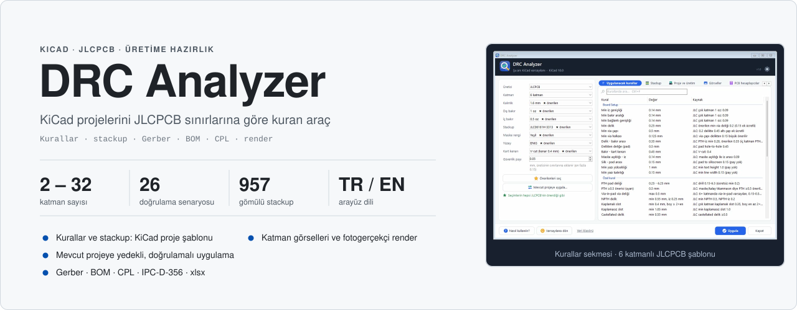
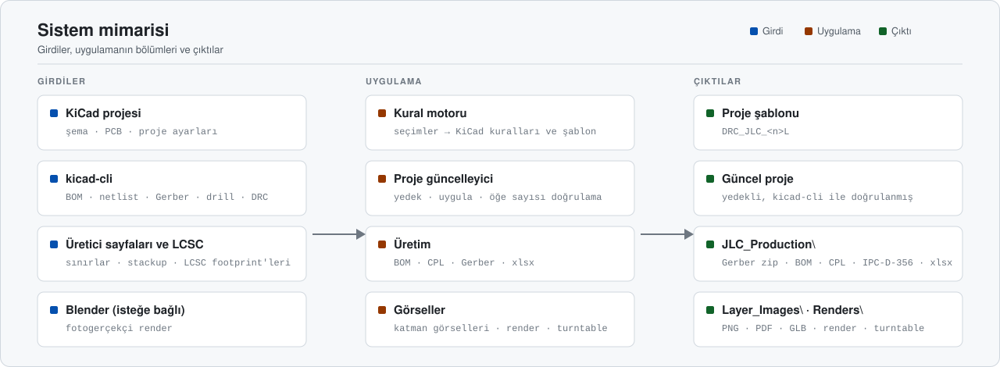
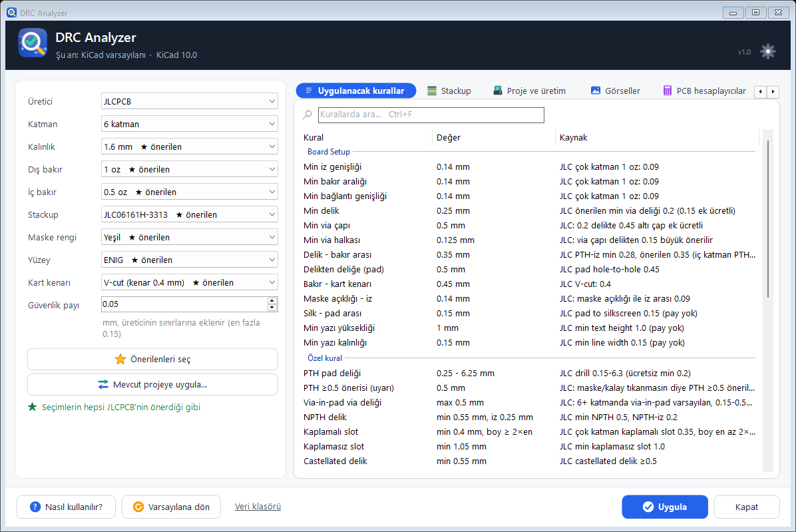
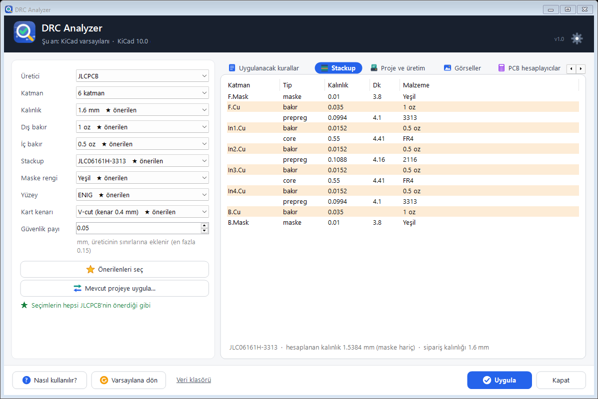
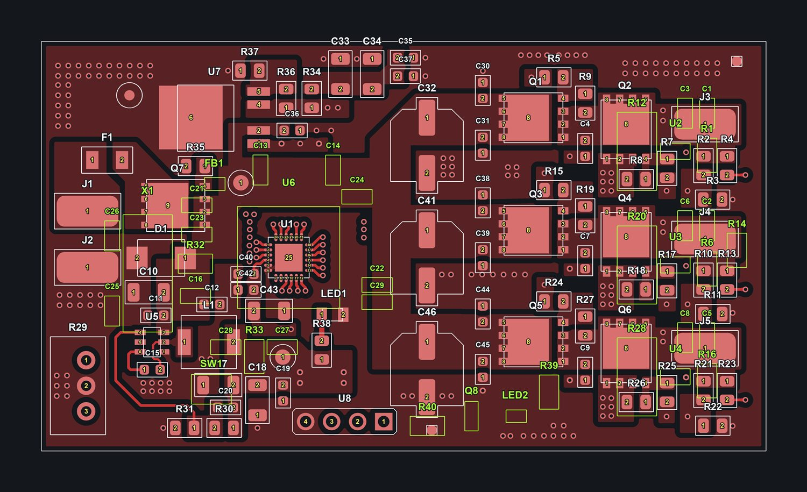
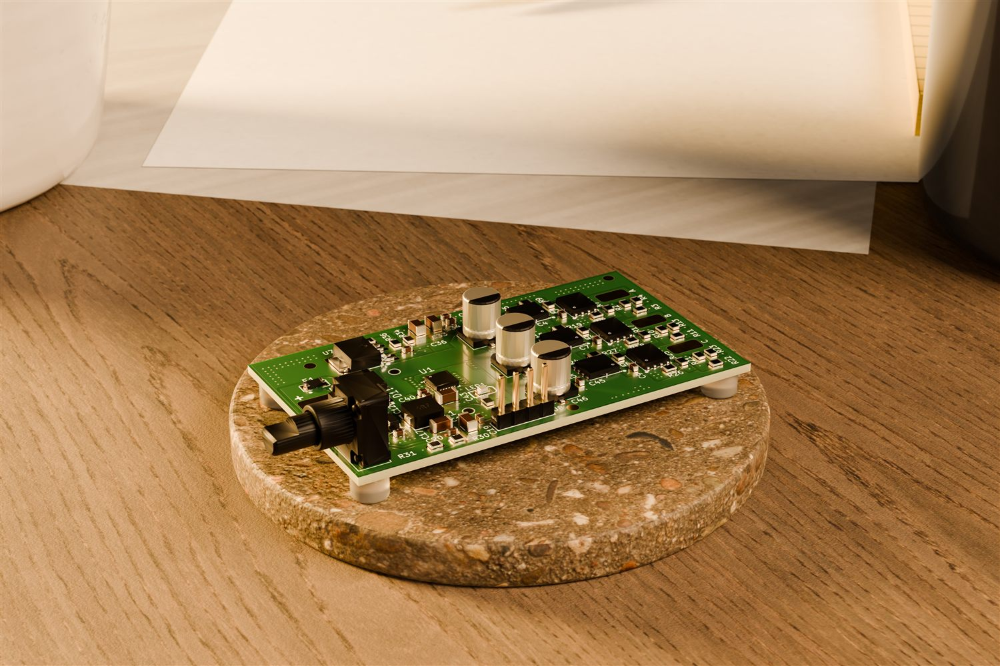
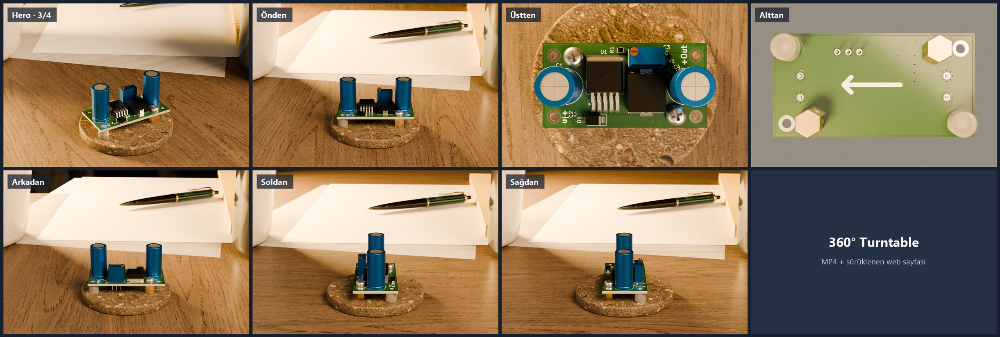

<div align="center">



<br/>

<a href="#-sistem-mimarisi"></a>
<a href="#-üretim-dosyaları"></a>
<a href="#-kaynak-kod"></a>


<br/><br/>

**KiCad projelerini JLCPCB'nin üretim sınırlarına göre kuran, üretim dosyalarını ve görselleri tek yerden çıkaran Windows aracı.**<br/>
Kurallar, stackup, Gerber, BOM, CPL, katman görselleri, fotogerçekçi render tek bir taşınabilir exe'de.

</div>


## İçindekiler

- [Genel bakış](#-genel-bakış)
- [Öne çıkanlar](#-öne-çıkanlar)
- [Sistem mimarisi](#-sistem-mimarisi)
- [Kurulum](#-kurulum)
- [Kullanım](#-kullanım)
- [Üretim dosyaları](#-üretim-dosyaları)
- [Görseller ve render](#-görseller-ve-render)
- [Doğrulama ve testler](#-doğrulama-ve-testler)
- [Kaynak kod](#-kaynak-kod)
- [Sınırlamalar](#-sınırlamalar)
- [Depo yapısı](#-depo-yapısı)

## ◆ Genel bakış

KiCad'de yeni bir kart tasarlarken üreticinin sınırlarını (en ince iz, en küçük delik, halka, maske açıklığı, stackup…) tek tek girmek hem zaman alır hem de hataya açıktır. **DRC Analyzer**, **JLCPCB**'nin yayımladığı sınırları KiCad kurallarına çevirir. Yeni projeler için hazır bir şablon yazar ya da kuralları mevcut bir projeye yedekli olarak uygular. Tasarım bitince JLCPCB'nin istediği **Gerber, BOM, CPL** ve netlist dosyalarını üretir, katman görsellerini ve fotogerçekçi bir render'ı hazırlar.

| Özellik | Değer |
|---|---|
| **Üretici** | JLCPCB ve PCBWay (yeni üretici eklemek için tek bir sınıf yazılır). Üretim dosyaları seçilen üreticiye göre üretilir: JLCPCB için BOM / CPL / LCSC kodları, PCBWay için PCBWay'in kendi KiCad rehberindeki Gerber ayarları ve üretici parça numaralı BOM |
| **Katman** | JLCPCB: 2 – 32 · JLC'nin sipariş sayfasındaki 957 stackup uygulamaya gömülü. PCBWay: 2 ve 4 – 16 · PCBWay'in 211 stackup'ı gömülü, dış bakır 1 – 3 oz, iç bakır 0.5 – 3 oz (sınırı yayınlanmış ağırlıklar) |
| **Seçimler** | Kalınlık, dış / iç bakır, stackup, maske rengi, yüzey kaplama, kart kenarı (V-cut / freze), güvenlik payı (0 – 0.15 mm) |
| **KiCad çıktısı** | Proje şablonu `DRC_JLC_<n>L`: kurallar, net class, iz / via ön ayarları, stackup, `.kicad_dru` özel kuralları |
| **Üretim çıktısı** | Gerber + drill zip, BOM, CPL, IPC-D-356 netlist, `Production.xlsx` (özet, BOM ve parça bilgileri, CPL) |
| **Parça kodları** | Her parçanın kodu KiCad'de sembolün özelliğine yazılır (`LCSC Part` ya da `DigiKey`); uygulama kodları şemadan okur, istenirse boş alanları tüm sembollere ekler. Kodu olmayan parça (test noktası gibi) hata sayılmaz |
| **Görseller** | Katman başına PNG, şematik PDF, 3B model (GLB), Blender ile render: hero, önden, üstten, alttan, arkadan, soldan, sağdan ve 360° turntable |
| **Arayüz** | Türkçe / English, açık / koyu tema, ayarlar sekmesi |
| **Gereksinim** | Windows 10 / 11 · KiCad 10 · kurulum yok, tek exe |

## ◆ Öne çıkanlar

<table>
<tr>
<td width="50%" valign="top">

**Kurallar KiCad'in kendisiyle doğrulanıyor**<br/>
"Uygula"dan sonra uygulama, bilerek hatalı yapılmış 19 öğe içeren bir test kartı yazıp `kicad-cli` ile DRC çalıştırır. Her kural kendi hatasını yakalamalı, kurala uyan öğelerde yanlış alarm olmamalıdır.

</td>
<td width="50%" valign="top">

**Mevcut projeye güvenli uygulama**<br/>
Katman sayısını artırıp azaltabilir, stackup ve kuralları değiştirir. Önce projenin yedeğini alır, DRC sayılarını öncesi ve sonrası karşılaştırır; işlemden sonra öğe sayılarını doğrular, bir sorun olursa yedeği geri yükler.

</td>
</tr>
<tr>
<td valign="top">

**Doğru dönen CPL**<br/>
Alt yüz dönüşü, KiCad kütüphane footprint'leri için JLC dönüş düzeltmeleri, THT parçalar için pad merkezi. EasyEDA / LCSC footprint'leri zaten JLC yönünde çizildiği için döndürülmez.

</td>
<td valign="top">

**Kodlar şemada yaşar**<br/>
Parçayı yerleştirirken `E` ile açılan pencereye parçanın kodunu yazmanız yeterli (`LCSC Part` ya da `DigiKey`). Uygulama projeyi seçince kodları şemadan okur ve her satırın kodunu `C242355-LCSC` gibi gösterir.

</td>
</tr>
<tr>
<td valign="top">

**Kartınızın fotoğrafı**<br/>
Blender ile kartı bir ceviz masa üzerinde, aydınlatılmış bir sahnede render eder; ayrıca bir tur dönen turntable (mp4 ve tarayıcıda sürüklenebilir sayfa) üretir.

</td>
<td valign="top">

</td>
</tr>
</table>

## ◆ Sistem mimarisi

<p align="center">
  
</p>

Uygulama dört kaynaktan beslenir:
- **KiCad projesi:** şema, PCB ve proje ayarları.
- **`kicad-cli`:** KiCad'in komut satırı aracı. BOM, netlist, Gerber, drill, DRC, şematik PDF ve GLB için kullanılır.
- **JLCPCB'nin herkese açık sayfaları:** üretim sınırları ve stackup listesi.
- **Blender (isteğe bağlı):** render ve turntable için.

Kural motoru seçimleri KiCad kurallarına çevirir. Kurallar ya ayrı bir klasördeki şablona ya da mevcut projeye yazılır. Üretim bölümü dosyaları projenin içindeki `JLC_Production` (PCBWay seçiliyse `PCBWay_Production`), görseller `Layer_Images` ve `Renders` klasörlerine koyar; proje dosyalarının kendisine yalnızca "Mevcut projeye uygula" yazar (yedekli).

## ◆ Kurulum

Hazır exe [Releases](https://github.com/Aykut-Gencer-KARACA/DRC-Analyzer/releases/latest) sayfasındadır; kaynak kod için [Kaynak kod](#-kaynak-kod) bölümüne bakın.

1. `DRC Analyzer.exe` dosyasını kendi klasörüne koyun, örneğin `C:\Projects\DRC\DRC Analyzer.exe`. Uygulama verilerini (`Data\`) exe'nin yanına yazar. Exe'nin klasörünün adı `Exe` ise `Data\` bir üst klasörde oluşturulur.
2. Çalıştırın. KiCad'in yeri otomatik bulunur; bulunamazsa sorulur.

> [!IMPORTANT]
> Exe'yi **Masaüstü** ya da **Belgeler** içine koymayın. Windows'un "Denetimli klasör erişimi" özelliği oraya yazmayı engelleyebilir.

> [!NOTE]
> İnternet yalnızca ilk render'da sahne varlıkları (≈ 35 MB, Poly Haven, CC0) için gerekir. Üretim dosyaları internetsiz de oluşur: JLC için dönüş kontrolünde yalnızca LCSC kodları gönderilip parçanın footprint'i alınır, 90 gün saklanır ve Ayarlar'dan kapatılabilir. Uygulama parça bilgisi, stok ya da fiyat sorgulamaz.

## ◆ Kullanım

Pencerede beş sekme vardır: **Uygulanacak kurallar · Stackup · Proje ve üretim · Görseller · Ayarlar**. Kısayollar: `F1` yardım, `F5` projeyi yeniden oku, `Ctrl+O` proje aç, `Ctrl+B` üretim, `Ctrl+R` render, `Ctrl+L` katman görselleri, `Ctrl+F` kurallarda ara, `Ctrl+1 … 5` sekmeler.

<details open>
<summary><b>1 · Kuralları seçin ve KiCad şablonu oluşturun</b></summary>
<br/>

Solda üretici, katman, kalınlık, bakır, stackup, maske, yüzey ve kart kenarını seçin. **★ önerilen**, JLCPCB'nin varsayılanıdır. "Uygulanacak kurallar" sekmesi her kuralın değerini ve kaynağını gösterir. **Uygula** düğmesi şablonu yazar ve KiCad ile doğrular. Ardından KiCad'de *File › New Project from Template* içinde `DRC_JLC_<n>L` seçilebilir. **Varsayılana dön** her şeyi geri alır; KiCad'in kendi "New Project" kuralları uygulama tarafından değiştirilmez.

<p align="center"></p>

</details>

<details>
<summary><b>2 · Stackup</b></summary>
<br/>

Seçilen JLC stackup'ının katmanları, kalınlıkları, Dk değerleri ve malzemeleri. Hesaplanan toplam kalınlık sipariş kalınlığıyla birlikte gösterilir.

<p align="center"></p>

</details>

<details>
<summary><b>3 · Mevcut projeye uygulayın</b></summary>
<br/>

**Mevcut projeye uygula…** seçilen kuralları bir KiCad projesine yazar:
- katman sayısı ve stackup;
- kart kuralları ve iz / via ön ayarları;
- uygulamanın `.kicad_dru` bloğu (kullanıcının kendi kuralları korunur ve önceliklidir).

İşlemden önce `Data\Project Backups\<ad>_<tarih>` altına yedek alınır, yazmadan hemen önce proje yeniden analiz edilir. Silinecek bir katmanda öğe varsa ya da proje KiCad'de açıksa (kilit dosyaları) işlem yapılmaz; bir hata olursa yedek geri yüklenir.

</details>

<details>
<summary><b>4 · Üretim dosyalarını oluşturun</b></summary>
<br/>

"Proje ve üretim" sekmesinde projeyi seçin (ya da pencereye bir proje / klasör / kart dosyası bırakın):
- soldaki ayarlar projeden okunur;
- BOM şemadan gelir ve değer + footprint + kod ile gruplanır;
- parça kodları KiCad'de sembolün özelliklerinden okunur (parçayı seç, `E`): `LCSC Part` ve `DigiKey`. Listede "Parça kodu" sütunu `C242355-LCSC` ya da `296-1234-ND-DigiKey` gibi gösterir; parça kodu (LCSC ya da DigiKey) olan her satır BOM'a ve CPL'ye girer; BOM her üretici için aynıdır ve her satırın kodu kendi tedarikçisinin sütunundadır (`LCSC Part #`, `DigiKey Part #`). Kodu olmayan satır hata değildir: başka yerden alınan parça ya da test noktasıdır. **Kod alanlarını ekle…** düğmesi her parçaya bu iki boş özelliği koyar (şematiğin yedeği önce alınır);
- BOM satırı en çok 200 designator içerir (JLC'nin sınırı; fazlası birkaç satıra bölünür), her designator yalnızca bir kez geçer; CPL milimetre cinsindendir, katman `top` / `bottom`.

**Üretim dosyalarını oluştur** düğmesine basın. JLC için CPL dönüşleri, parçanın kendi LCSC footprint'i (EasyEDA) ile karşılaştırılarak yazılır; bunun için yalnızca LCSC kodları gönderilir, footprint'ler 90 gün saklanır (Ayarlar › Üretim'den kapatılabilir). Dönüşü doğrulanamayan bir parça JLC önizlemesinde dönük görünürse KiCad'de sembolüne `Rotation Offset` özelliğini (derece, örn. 90) ekleyip yeniden oluşturun. PCBWay için KiCad'in kendi dönüşü yazılır. Elle takacağınız ya da başka yerden alacağınız parçalara o üreticinin kodunu yazmayın; dosyalara girmezler.

</details>

<details>
<summary><b>5 · Ayarlar</b></summary>
<br/>

Dil (EN / TR), tema (açık / koyu / Windows'a göre), render kalitesi ve görünümleri, "her render'dan önce sor", yalnızca işlemci, Blender yolu. Üstteki dişli simgesi bu sekmeyi açar. Uzun işler (üretim, render) biterken görev çubuğunda ilerleme gösterilir ve bildirim verilir.

</details>

## ◆ Üretim dosyaları

Dosyalar `<proje>\JLC_Production\` klasörüne yazılır (soldaki üretici PCBWay ise `<proje>\PCBWay_Production\`: Gerber PCBWay rehberindeki ayarlarla (KiCad uzantıları, X2 yok, PTH + NPTH tek drill dosyası) ve `_CPL_PCBWay.csv` KiCad'in kendi konum dosyası biçiminde; BOM, netlist ve xlsx aynıdır). Revizyon, PCB başlık bloğundan, yoksa şematiğin başlık bloğundan, yoksa klasör adından (`RevC`) alınır.

| Dosya | İçerik |
|---|---|
| `<ad>_Rev<x>_Gerber.zip` | Gerber (zone'lar yeniden doldurulmuş, X2) + Excellon drill (mm), PTH / NPTH ayrı, drill haritası |
| `<ad>_Rev<x>_BOM.csv` | BOM, her üretici için aynı: designator, footprint, adet, değer, `LCSC Part #`, `DigiKey Part #`, üretici, üretici parça no (Fabrication Toolkit eklentisiyle aynı ilk sütunlar) |
| `<ad>_Rev<x>_CPL_JLC.csv` | Yerleşim dosyası · yalnızca dizilecek parçalar |
| `<ad>_Rev<x>_Netlist.ipc` | IPC-D-356 netlist: JLC, Gerber'i bağlantılarla karşılaştırabilir |
| `<ad>_Rev<x>_Production.xlsx` | Yatay özet sayfası (rakam kutuları: parça çeşidi, komponent, üst / alt yüz, katman, kalınlık, bakır, en küçük iz ve delik; proje ve sipariş formu yan yana; parça dağılımı ve grafiği; onay satırı), BOM ve CPL sayfaları, seçili dilde; dışarıdan veri yok |

BOM ve CPL sütunları, JLCPCB'nin KiCad rehberinde önerdiği [Fabrication Toolkit](https://github.com/bennymeg/Fabrication-Toolkit) eklentisinin çıktısıyla aynıdır ve JLCPCB'nin yayımladığı kurallara uyar (CPL: `Designator, Mid X, Mid Y, Rotation, Layer`). JLC alt yüzdeki parçaların dönüş kuralını yayımlamaz; bu yüzden ilk siparişte yerleşim önizlemesine bakılması önerilir.

<details>
<summary><b>CPL dönüşleri</b></summary>
<br/>

- Alt yüzdeki parçaların dönüşü `180 − açı` olarak yazılır.
- KiCad kütüphane footprint'lerinden sıfır yönü JLC'ninkinden farklı olanlar (SOT-23, SOIC, QFN…) Fabrication Toolkit tablosuna göre düzeltilir.
- EasyEDA / LCSC footprint'leri JLC yönünde çizildiği için düzeltilmez. Eklenti bunları adlarından tanıyıp fazladan döndürüyor; bu uygulama döndürmez.
- Kutuplu kondansatörler (CP_Elec, CP_EIA…) döndürülmez. JLC'deki yönleri seçilen parçaya bağlıdır; bu yüzden uygulama onları JLC önizlemesinde kontrol edilmek üzere listeler.
- THT parçalar pad'lerin merkezine yerleştirilir.

Düzeltilen her parça, üretimden sonra bir not olarak gösterilir. Siparişten önce JLC önizlemesinde bu parçalara bakmak yeterli.

</details>

> [!NOTE]
> Uygulama **fiyat, stok ya da maliyet göstermez**; son fiyatı üreticinin teklifi belirler.

## ◆ Görseller ve render

Aynı sekmedeki iki düğme, projeyi yalnızca okuyarak görsel üretir:

<table>
<tr>
<td width="50%"></td>
<td width="50%"></td>
</tr>
<tr>
<td align="center"><sub>Katman görselleri · <code>Layer_Images\TopLayer.png</code></sub></td>
<td align="center"><sub>Render · <code>Renders\*_Hero.png</code> (Blender)</sub></td>
</tr>
</table>

| Düğme | Çıktı klasörü | İçerik |
|---|---|---|
| **Katman görselleri** | `<proje>\Layer_Images\` | Her bakır katmanı için PNG (`TopLayer`, `In1` … `InN`, `BottomLayer`; KiCad renkleri, parça çerçeveleri, referanslar, pad numaraları), şematik PDF, 3B model `<ad>_Rev<x>.glb` |
| **Render** | `<proje>\Renders\` | Seçilen görünümler: `_Hero.png` (sol önden 3/4), `_Front.png`, `_Top.png`, `_Bottom.png`, `_Back.png`, `_Left.png`, `_Right.png`; ayrıca `_Turntable.mp4` ve `_Turntable\index.html` (sürüklenerek döndürülen sayfa) |

Render penceresindeki görünümler (hero ve önden varsayılandır, diğerleri isteğe bağlıdır; komut satırında `--views`):

<p align="center"></p>

| Görünüm | Kamera | Sahne |
|---|---|---|
| `hero` | sol önden, 3/4, yukarıdan | masa, disk, kağıt, bitki, kupa |
| `front` · `back` | karşıdan / arkadan, biraz yukarıdan | aynı sahne |
| `left` · `right` | soldan / sağdan, alçaktan (kartın profili ve parça yükseklikleri) | aynı sahne |
| `top` | tam yukarıdan, kartın dış çizgisi kareyi doldurur | masa ve disk, aksesuarsız |
| `bottom` | tam aşağıdan; kart havada tutulur, alt yüz alttan aydınlatılır | düz gri fon, aksesuarsız |

Render, **Blender 4.2 veya üstü** gerektirir (otomatik bulunur ya da bir kez seçilir). Sahne: ince bir taş sunum diski üzerinde kart, ceviz masa, kağıtlar, kalem, bitki ve kupa; sıcak yumuşak ana ışık. Kartın boyutuna, maske rengine ve yüzey kaplamasına göre ölçeklenir. Kalite: hızlı önizleme (≈ 2 dk), yüksek (≈ 12 dk), maksimum (≈ 80 dk); süreler yaklaşıktır ve bilgisayara bağlıdır. Render durdurulabilir; biten fotoğraflar kalır. 3B modeli olmayan parçalar ve doldurulmamış zone'lar not olarak bildirilir.

## ◆ Doğrulama ve testler

Test betikleri kaynak kodla birlikte (`Development/Tests`, özel depoda) durur ve exe'yi yansıma (reflection) ile yükler; proje üzerinde çalışan testler projenin **kopyası** ile çalıştırılır, pencere ekran dışında açılır.

| Test | Ne yapar | Sonuç |
|---|---|---|
| `unit-tests.ps1` | Saf fonksiyonlar: dosya adları, CSV, CPL dönüşleri, CPL / BOM eşleşmesi, kutuplu kondansatörler, pad merkezleri, şema kodları, revizyon, S-expression, `.kicad_dru`, JSON, PCBWay kural değerleri | 247 / 247 |
| `gui-tests.ps1` | Gerçek pencereyi ekran dışında sürer: dil değişimi, üretim, projeye uygulama, uygula + doğrula, varsayılana dönüş, PCBWay seçimi (kurallar, uygula + doğrula), sekmelere göre alt çubuk ve sol panel, çalışırken kapatma, xlsx'in açılabilirliği | 52 / 52 |
| `ui-tests.ps1` | Son kullanılanlar, sürükle-bırak, kısayollar, hakkında, Görseller sekmesi, ilk açılış turu, kural arama, koyu tema (her sekmede kontrast denetimi), ayarlar | 71 / 71 |
| `layer-images-tests.ps1` | Katman görselleri: komut satırı, eski görsellerin silinmesi, düğme, proje dosyalarının değişmemesi | 13 / 13 |
| `render-tests.ps1` | Render (küçük boyutlarla): komut satırı ve seçenekler, ek görünümler, düğme, yarıda durdurma, proje dosyalarının değişmemesi | 40 / 40 |
| `run-tests.ps1` | JLCPCB için 26, PCBWay için 22 senaryoda (katman sayıları, bakır, pay, kenar, maske, kaplama…) KiCad doğrulaması | 26 / 26 ve 22 / 22 |

Son koşu v1.1 için 2026-11-18'dir: tüm paketler (birim, gui, arayüz, katman görselleri, render ve iki üreticinin KiCad doğrulaması) proje kopyaları üzerinde geçti.

<details>
<summary><b>Komut satırı</b></summary>
<br/>

```text
"DRC Analyzer.exe" --help
"DRC Analyzer.exe" --lang en --layers 6 --verify                    kuralları KiCad ile doğrula
"DRC Analyzer.exe" --layers 6 --project X.kicad_pro --analyze       projeyi incele
"DRC Analyzer.exe" --layers 6 --project X.kicad_pro --update        kuralları projeye uygula (yedekli)
"DRC Analyzer.exe" --layers 6 --project X.kicad_pro --bom --build
                                                                    BOM'u listele, üretim dosyalarını oluştur
"DRC Analyzer.exe" --project X.kicad_pro --layer-images             katman görselleri, şematik PDF, GLB
"DRC Analyzer.exe" --project X.kicad_pro --render --quality preview Blender ile render
"DRC Analyzer.exe" --project X.kicad_pro --render --views top,bottom,left   yalnızca seçilen görünümler
```

Exe bir pencere uygulaması olduğu için PowerShell'de çıktıyı beklemek üzere sonuna `| Out-String` ekleyin.

</details>

## ◆ Kaynak kod

Kaynak kod (`Development/`) bu deponun özel kopyasında tutulur; herkese açık depo hazır exe'yi, belgeleri ve görselleri içerir. Teknik özet:

- Kod C# 5, WinForms; Windows'taki .NET Framework 4 derleyicisiyle (`csc.exe`) derlenir, ek SDK gerekmez. Stackup listeleri ve Blender / KiCad betikleri exe'ye gömülür.
- Tüm kullanıcı metinleri tek yerde, Türkçe ve İngilizce.
- Yeni bir üretici eklemek için ortak taban sınıftan türeyen tek bir sınıf yazmak yeterlidir.
- Komut satırı seçeneklerinin tam listesi için `DRC Analyzer.exe --help`.

## ◆ Sınırlamalar

- **KiCad 10** ile geliştirildi ve test edildi (10.0.6); diğer sürümler denenmedi.
- Yalnızca Windows; kurallar JLCPCB ve PCBWay için var, başka üreticiler (ve Altium) planlanıyor. PCBWay kuralları üreticinin kabiliyet sayfasındaki "normal proses" değerleridir; sayfada olmayan değerler için kural yazılmaz; her kuralın kaynağı uygulamadaki kural tablosunda görünür.
- JLC dönüş kontrolünde kullanılan LCSC (EasyEDA) footprint servisi resmî bir API değildir; ulaşılamazsa o parçalar "doğrulanamadı" diye listelenir ve kendi dönüşleriyle kalır, uygulama çalışmaya devam eder. Dönüşü yanlış çıkan parça için sembole `Rotation Offset` yazılabilir.
- Fiyat, stok ve maliyet hesaplanmaz.
- Tray bildirimi ve render'ın görünümü otomatik testle denetlenmez; render çıktıları elle gözden geçirilir.

## ◆ Depo yapısı

```text
DRC-Analyzer/
├─ assets/                 README görselleri
└─ README.md
```

Derlenmiş `DRC Analyzer.exe` depo dosyalarında değildir, [Releases](https://github.com/Aykut-Gencer-KARACA/DRC-Analyzer/releases/latest) sayfasından indirilir. Uygulamanın çalışırken oluşturduğu `Data\` klasörü de depoya girmez.

<details>
<summary><b>Üçüncü taraf kaynaklar</b></summary>
<br/>

- **Fabrication Toolkit** ([bennymeg/Fabrication-Toolkit](https://github.com/bennymeg/Fabrication-Toolkit), Apache-2.0): KiCad footprint'leri için JLC dönüş tablosu ve BOM / CPL sütun düzeni.
- **Poly Haven** ([polyhaven.com](https://polyhaven.com), CC0): render sahnesinin ceviz dokusu, bitkisi, kağıtları, kalemi ve oda ışığı; ilk render'da indirilir, depoda yoktur.

</details>

<br/>

<div align="center">

<br/>
<sub>KiCad · JLCPCB · kicad-cli · Blender · C# · WinForms</sub>
</div>
