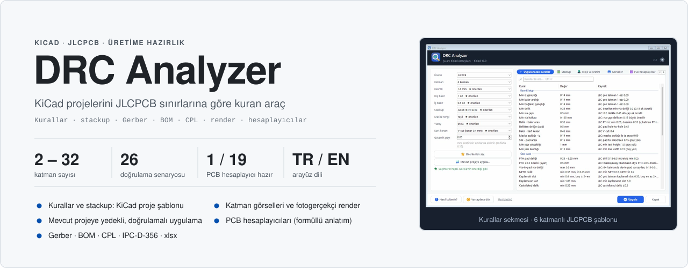
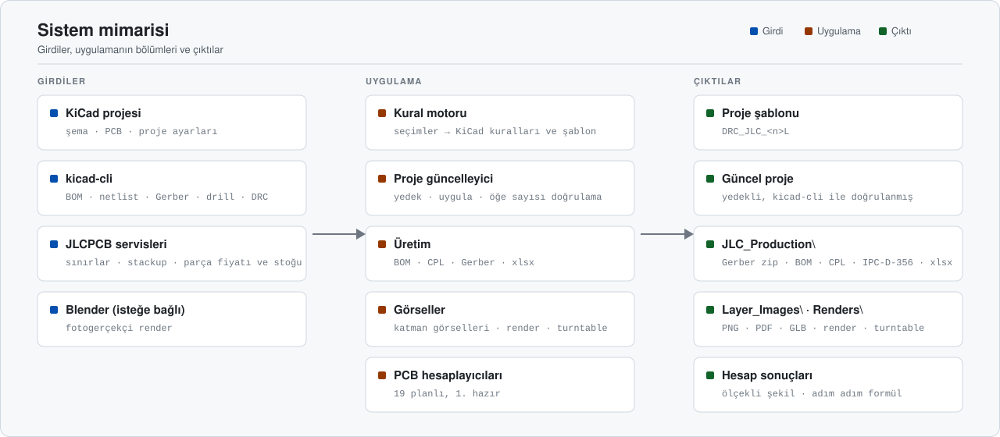
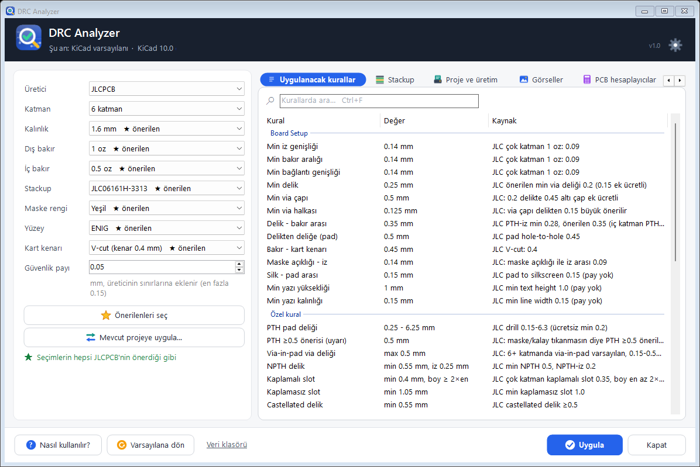
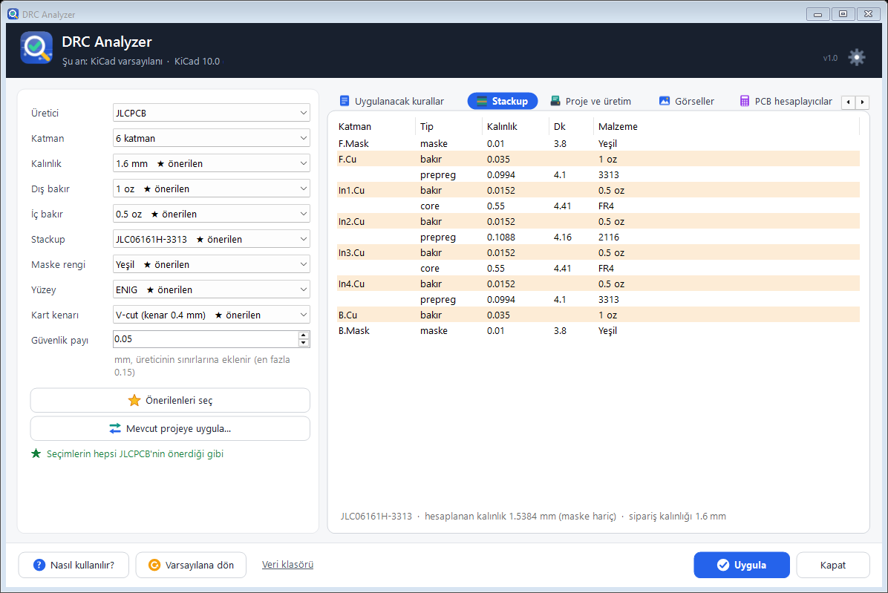
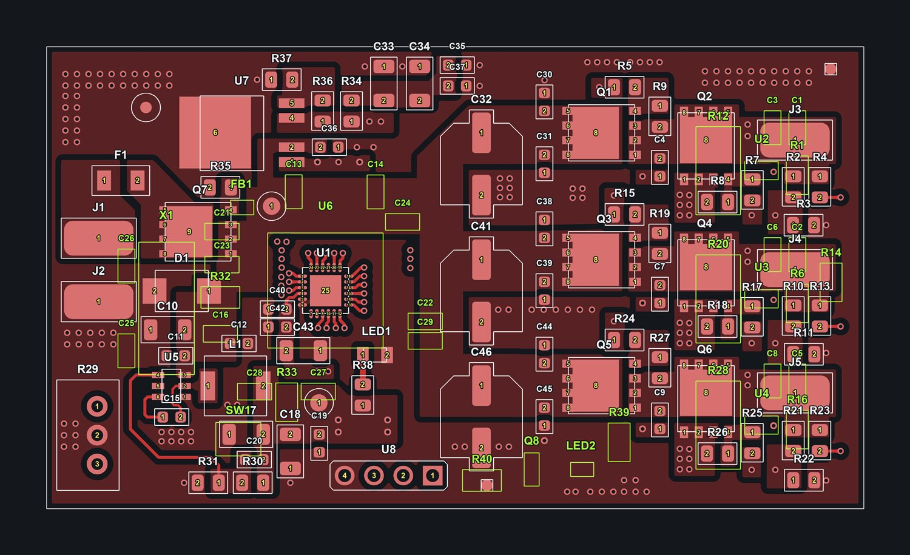
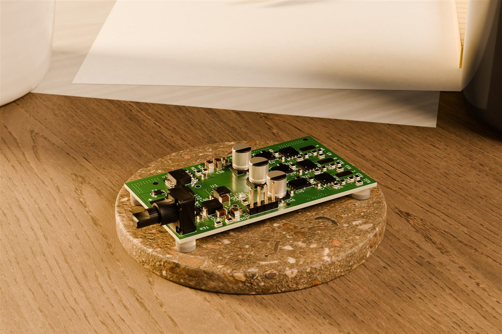
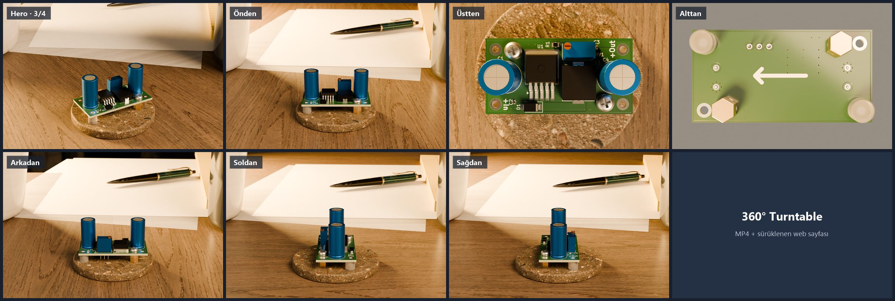
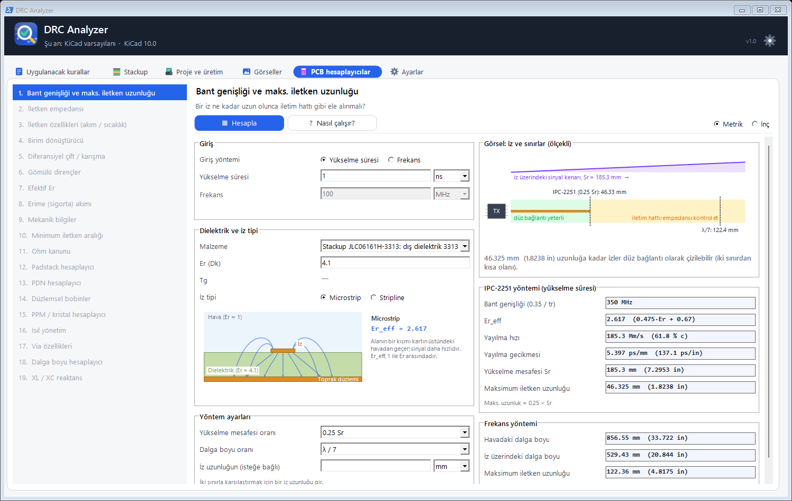
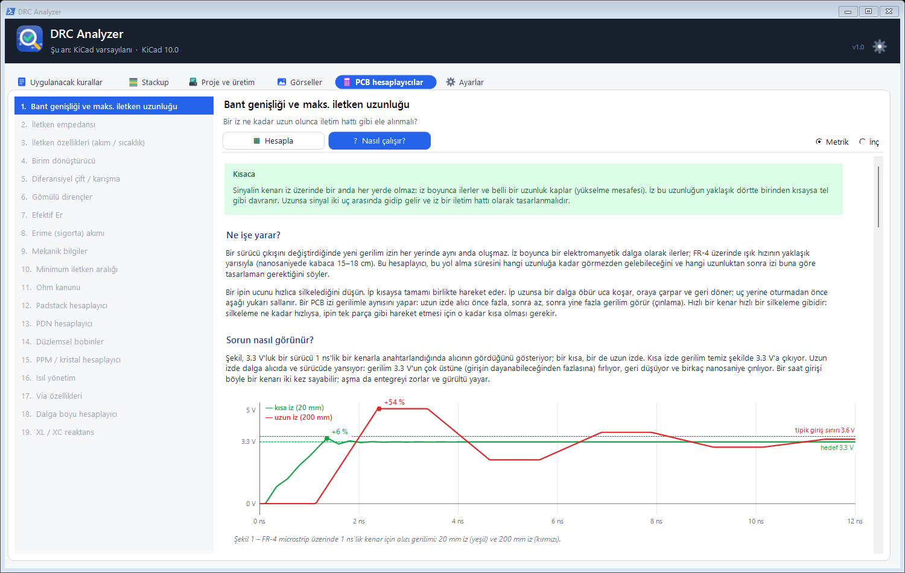

<div align="center">



<br/>

<a href="#-sistem-mimarisi"></a>
<a href="#-üretim-dosyaları"></a>
<a href="#-kaynaktan-derleme"></a>


<br/><br/>

**KiCad projelerini JLCPCB'nin üretim sınırlarına göre kuran, üretim dosyalarını ve görselleri tek yerden çıkaran Windows aracı.**<br/>
Kurallar, stackup, Gerber, BOM, CPL, katman görselleri, fotogerçekçi render ve PCB hesaplayıcıları tek bir taşınabilir exe'de.

</div>


## İçindekiler

- [Genel bakış](#-genel-bakış)
- [Öne çıkanlar](#-öne-çıkanlar)
- [Sistem mimarisi](#-sistem-mimarisi)
- [Kurulum](#-kurulum)
- [Kullanım](#-kullanım)
- [Üretim dosyaları](#-üretim-dosyaları)
- [Görseller ve render](#-görseller-ve-render)
- [PCB hesaplayıcıları](#-pcb-hesaplayıcıları)
- [Doğrulama ve testler](#-doğrulama-ve-testler)
- [Kaynaktan derleme](#-kaynaktan-derleme)
- [Sınırlamalar](#-sınırlamalar)
- [Depo yapısı](#-depo-yapısı)

## ◆ Genel bakış

KiCad'de yeni bir kart tasarlarken üreticinin sınırlarını (en ince iz, en küçük delik, halka, maske açıklığı, stackup…) tek tek girmek hem zaman alır hem de hataya açıktır. **DRC Analyzer**, **JLCPCB**'nin yayımladığı sınırları KiCad kurallarına çevirir. Yeni projeler için hazır bir şablon yazar ya da kuralları mevcut bir projeye yedekli olarak uygular. Tasarım bitince JLCPCB'nin istediği **Gerber, BOM, CPL** ve netlist dosyalarını üretir, katman görsellerini ve fotogerçekçi bir render'ı hazırlar.

| Özellik | Değer |
|---|---|
| **Üretici** | JLCPCB (yeni üretici eklemek için tek bir sınıf yazılır) |
| **Katman** | 2 – 32 · JLC'nin sipariş sayfasındaki 957 stackup uygulamaya gömülü |
| **Seçimler** | Kalınlık, dış / iç bakır, stackup, maske rengi, yüzey kaplama, kart kenarı (V-cut / freze), güvenlik payı (0 – 0.15 mm) |
| **KiCad çıktısı** | Proje şablonu `DRC_JLC_<n>L`: kurallar, net class, iz / via ön ayarları, stackup, `.kicad_dru` özel kuralları |
| **Üretim çıktısı** | Gerber + drill zip, BOM, CPL, IPC-D-356 netlist, `Production.xlsx` (özet, BOM ve parça bilgileri, CPL) |
| **Parça kodları** | Şemadaki `LCSC Part` alanından okunur; eksikler uygulamada girilebilir ya da dosyadan alınabilir |
| **Görseller** | Katman başına PNG, şematik PDF, 3B model (GLB), Blender ile render: hero, önden, üstten, alttan, arkadan, soldan, sağdan ve 360° turntable |
| **Hesaplayıcılar** | 19 PCB hesaplayıcısı planlı; 1. hazır (bant genişliği ve maks. iletken uzunluğu) |
| **Arayüz** | Türkçe / English, açık / koyu tema, ayarlar sekmesi |
| **Gereksinim** | Windows 10 / 11 · KiCad 10 · kurulum yok, tek exe |

## ◆ Öne çıkanlar

<table>
<tr>
<td width="50%" valign="top">

**Kurallar KiCad'in kendisiyle doğrulanıyor**<br/>
"Uygula"dan sonra uygulama, bilerek hatalı yapılmış 19 öğe içeren bir test kartı yazıp `kicad-cli` ile DRC çalıştırır. Her kural kendi hatasını yakalamalı, kurala uyan öğelerde yanlış alarm olmamalıdır.

</td>
<td width="50%" valign="top">

**Mevcut projeye güvenli uygulama**<br/>
Katman sayısını artırıp azaltabilir, stackup ve kuralları değiştirir. Önce projenin yedeğini alır, DRC sayılarını öncesi ve sonrası karşılaştırır; işlemden sonra öğe sayılarını doğrular, bir sorun olursa yedeği geri yükler.

</td>
</tr>
<tr>
<td valign="top">

**Doğru dönen CPL**<br/>
Alt yüz dönüşü, KiCad kütüphane footprint'leri için JLC dönüş düzeltmeleri, THT parçalar için pad merkezi. EasyEDA / LCSC footprint'leri zaten JLC yönünde çizildiği için döndürülmez.

</td>
<td valign="top">

**Kodlar şemada yaşar**<br/>
Parçayı yerleştirirken `E` ile açılan pencereye LCSC kodunu yazmanız yeterli. Uygulama projeyi seçince kodları şemadan okur; eksik kodları, JLC parça bilgisini ve stok sorunlarını gösterir.

</td>
</tr>
<tr>
<td valign="top">

**Kartınızın fotoğrafı**<br/>
Blender ile kartı bir ceviz masa üzerinde, aydınlatılmış bir sahnede render eder; ayrıca bir tur dönen turntable (mp4 ve tarayıcıda sürüklenebilir sayfa) üretir.

</td>
<td valign="top">

**Formülü gösteren hesaplayıcılar**<br/>
Her hesaplayıcının bir "Nasıl çalışır?" sayfası var: fiziksel açıklama, ölçekli şekiller, adım adım formül ve örnek. Değerler seçilen JLC stackup'ından gelir.

</td>
</tr>
</table>

## ◆ Sistem mimarisi

<p align="center">
  
</p>

Uygulama dört kaynaktan beslenir:
- **KiCad projesi:** şema, PCB ve proje ayarları.
- **`kicad-cli`:** KiCad'in komut satırı aracı. BOM, netlist, Gerber, drill, DRC, şematik PDF ve GLB için kullanılır.
- **JLCPCB'nin herkese açık sayfaları ve servisleri:** üretim sınırları, stackup listesi, parça bilgisi, fiyat ve stok.
- **Blender (isteğe bağlı):** render ve turntable için.

Kural motoru seçimleri KiCad kurallarına çevirir. Kurallar ya ayrı bir klasördeki şablona ya da mevcut projeye yazılır. Üretim bölümü dosyaları projenin içindeki `JLC_Production`, görseller `Layer_Images` ve `Renders` klasörlerine koyar; proje dosyalarının kendisine yalnızca "Mevcut projeye uygula" yazar (yedekli).

## ◆ Kurulum

Hazır exe [Releases](https://github.com/Aykut-Gencer-KARACA/DRC-Analyzer/releases/latest) sayfasındadır; isterseniz [kaynaktan derleyebilirsiniz](#-kaynaktan-derleme) (tek komut).

1. `DRC Analyzer.exe` dosyasını kendi klasörüne koyun, örneğin `C:\Projects\DRC\DRC Analyzer.exe`. Uygulama verilerini (`Data\`) exe'nin yanına yazar. Exe'nin klasörünün adı `Exe` ise `Data\` bir üst klasörde oluşturulur.
2. Çalıştırın. KiCad'in yeri otomatik bulunur; bulunamazsa sorulur.

> [!IMPORTANT]
> Exe'yi **Masaüstü** ya da **Belgeler** içine koymayın. Windows'un "Denetimli klasör erişimi" özelliği oraya yazmayı engelleyebilir.

> [!NOTE]
> İnternet yalnızca JLC parça bilgisi (üretici, stok, fiyat) ve ilk render'da sahne varlıkları (≈ 35 MB, Poly Haven, CC0) için gerekir. Bağlantı yoksa üretim dosyaları yine oluşur; xlsx'teki fiyat ve stok sütunları boş kalır.

## ◆ Kullanım

Pencerede altı sekme vardır: **Uygulanacak kurallar · Stackup · Proje ve üretim · Görseller · PCB hesaplayıcıları · Ayarlar**. Kısayollar: `F1` yardım, `F5` projeyi yeniden oku, `Ctrl+O` proje aç, `Ctrl+B` üretim, `Ctrl+R` render, `Ctrl+L` katman görselleri, `Ctrl+F` kurallarda ara, `Ctrl+1 … 5` sekmeler.

<details open>
<summary><b>1 · Kuralları seçin ve KiCad şablonu oluşturun</b></summary>
<br/>

Solda üretici, katman, kalınlık, bakır, stackup, maske, yüzey ve kart kenarını seçin. **★ önerilen**, JLCPCB'nin varsayılanıdır. "Uygulanacak kurallar" sekmesi her kuralın değerini ve kaynağını gösterir. **Uygula** düğmesi şablonu yazar ve KiCad ile doğrular. Ardından KiCad'de *File › New Project from Template* içinde `DRC_JLC_<n>L` seçilebilir. **Varsayılana dön** her şeyi geri alır; KiCad'in kendi "New Project" kuralları uygulama tarafından değiştirilmez.

<p align="center"></p>

</details>

<details>
<summary><b>2 · Stackup</b></summary>
<br/>

Seçilen JLC stackup'ının katmanları, kalınlıkları, Dk değerleri ve malzemeleri. Hesaplanan toplam kalınlık sipariş kalınlığıyla birlikte gösterilir.

<p align="center"></p>

</details>

<details>
<summary><b>3 · Mevcut projeye uygulayın</b></summary>
<br/>

**Mevcut projeye uygula…** seçilen kuralları bir KiCad projesine yazar:
- katman sayısı ve stackup;
- kart kuralları ve iz / via ön ayarları;
- uygulamanın `.kicad_dru` bloğu (kullanıcının kendi kuralları korunur ve önceliklidir).

İşlemden önce `Data\Project Backups\<ad>_<tarih>` altına yedek alınır, yazmadan hemen önce proje yeniden analiz edilir. Silinecek bir katmanda öğe varsa ya da proje KiCad'de açıksa (kilit dosyaları) işlem yapılmaz; bir hata olursa yedek geri yüklenir.

</details>

<details>
<summary><b>4 · Üretim dosyalarını oluşturun</b></summary>
<br/>

"Proje ve üretim" sekmesinde projeyi seçin (ya da pencereye bir proje / klasör / kart dosyası bırakın):
- soldaki ayarlar projeden okunur;
- BOM şemadan gelir ve değer + footprint + kod ile gruplanır;
- LCSC kodları şemadaki `LCSC Part` alanından okunur (mavi satırlar); eksikler yazılabilir ya da dosyadan alınabilir;
- özet kartları parça sayısını, kodları ve JLC stoğunu gösterir (stoğu yetmeyen parçaların adı kartta yazar).

Elle dizilecek parçaların **Dizilsin** işaretini kaldırın, kart adedini girin ve **Üretim dosyalarını oluştur** düğmesine basın.

</details>

<details>
<summary><b>5 · Ayarlar</b></summary>
<br/>

Dil (EN / TR), tema (açık / koyu / Windows'a göre), hesaplayıcı birimleri (metrik / inç), render kalitesi ve görünümleri, "her render'dan önce sor", yalnızca işlemci, Blender yolu ve varsayılan kart adedi. Üstteki dişli simgesi bu sekmeyi açar. Uzun işler (üretim, render) biterken görev çubuğunda ilerleme gösterilir ve bildirim verilir.

</details>

## ◆ Üretim dosyaları

Dosyalar `<proje>\JLC_Production\` klasörüne yazılır. Revizyon, PCB başlık bloğundan, yoksa şematiğin başlık bloğundan, yoksa klasör adından (`RevC`) alınır.

| Dosya | İçerik |
|---|---|
| `<ad>_Rev<x>_Gerber.zip` | Gerber (zone'lar yeniden doldurulmuş, X2) + Excellon drill (mm), PTH / NPTH ayrı, drill haritası |
| `<ad>_Rev<x>_BOM_JLC.csv` | BOM, LCSC kodlarıyla (Fabrication Toolkit eklentisiyle aynı sütunlar) |
| `<ad>_Rev<x>_CPL_JLC.csv` | Yerleşim dosyası · yalnızca dizilecek parçalar |
| `<ad>_Rev<x>_Netlist.ipc` | IPC-D-356 netlist: JLC, Gerber'i bağlantılarla karşılaştırabilir |
| `<ad>_Rev<x>_Production.xlsx` | Sipariş özeti, parça bilgisi ve stok, BOM, CPL (seçili dilde) |

BOM ve CPL sütunları, JLCPCB'nin KiCad rehberinde önerdiği [Fabrication Toolkit](https://github.com/bennymeg/Fabrication-Toolkit) eklentisiyle aynıdır.

<details>
<summary><b>CPL dönüşleri</b></summary>
<br/>

- Alt yüzdeki parçaların dönüşü `180 − açı` olarak yazılır.
- KiCad kütüphane footprint'lerinden sıfır yönü JLC'ninkinden farklı olanlar (SOT-23, SOIC, QFN…) Fabrication Toolkit tablosuna göre düzeltilir.
- EasyEDA / LCSC footprint'leri JLC yönünde çizildiği için düzeltilmez. Eklenti bunları adlarından tanıyıp fazladan döndürüyor; bu uygulama döndürmez.
- Kutuplu kondansatörler (CP_Elec, CP_EIA…) döndürülmez. JLC'deki yönleri seçilen parçaya bağlıdır; bu yüzden uygulama onları JLC önizlemesinde kontrol edilmek üzere listeler.
- THT parçalar pad'lerin merkezine yerleştirilir.

Düzeltilen her parça, üretimden sonra bir not olarak gösterilir. Siparişten önce JLC önizlemesinde bu parçalara bakmak yeterli.

</details>

> [!NOTE]
> Uygulama parça fiyatını ve stoğu gösterir; bir **maliyet tahmini ya da montaj ücreti hesabı yapmaz**. Son fiyatı JLC'nin teklifi belirler.

## ◆ Görseller ve render

Aynı sekmedeki iki düğme, projeyi yalnızca okuyarak görsel üretir:

<table>
<tr>
<td width="50%"></td>
<td width="50%"></td>
</tr>
<tr>
<td align="center"><sub>Katman görselleri · <code>Layer_Images\TopLayer.png</code></sub></td>
<td align="center"><sub>Render · <code>Renders\*_Hero.png</code> (Blender)</sub></td>
</tr>
</table>

| Düğme | Çıktı klasörü | İçerik |
|---|---|---|
| **Katman görselleri** | `<proje>\Layer_Images\` | Her bakır katmanı için PNG (`TopLayer`, `In1` … `InN`, `BottomLayer`; KiCad renkleri, parça çerçeveleri, referanslar, pad numaraları), şematik PDF, 3B model `<ad>_Rev<x>.glb` |
| **Render** | `<proje>\Renders\` | Seçilen görünümler: `_Hero.png` (sol önden 3/4), `_Front.png`, `_Top.png`, `_Bottom.png`, `_Back.png`, `_Left.png`, `_Right.png`; ayrıca `_Turntable.mp4` ve `_Turntable\index.html` (sürüklenerek döndürülen sayfa) |

Render penceresindeki görünümler (hero ve önden varsayılandır, diğerleri isteğe bağlıdır; komut satırında `--views`):

<p align="center"></p>

| Görünüm | Kamera | Sahne |
|---|---|---|
| `hero` | sol önden, 3/4, yukarıdan | masa, disk, kağıt, bitki, kupa |
| `front` · `back` | karşıdan / arkadan, biraz yukarıdan | aynı sahne |
| `left` · `right` | soldan / sağdan, alçaktan (kartın profili ve parça yükseklikleri) | aynı sahne |
| `top` | tam yukarıdan, kartın dış çizgisi kareyi doldurur | masa ve disk, aksesuarsız |
| `bottom` | tam aşağıdan; kart havada tutulur, alt yüz alttan aydınlatılır | düz gri fon, aksesuarsız |

Render, **Blender 4.2 veya üstü** gerektirir (otomatik bulunur ya da bir kez seçilir). Sahne: ince bir taş sunum diski üzerinde kart, ceviz masa, kağıtlar, kalem, bitki ve kupa; sıcak yumuşak ana ışık. Kartın boyutuna, maske rengine ve yüzey kaplamasına göre ölçeklenir. Kalite: hızlı önizleme (≈ 2 dk), yüksek (≈ 12 dk), maksimum (≈ 80 dk); süreler RTX 4050 dizüstü GPU'da ölçülmüştür. Render durdurulabilir; biten fotoğraflar kalır. 3B modeli olmayan parçalar ve doldurulmamış zone'lar not olarak bildirilir.

## ◆ PCB hesaplayıcıları

Saturn PCB Toolkit'in 19 sekmesinin geliştirilmiş karşılıkları, yayımlanmış formüllerle (IPC standartları, el kitapları) yazılıyor. Değerler seçili JLC stackup'ından gelir; her hesaplayıcının bir **"Nasıl çalışır?"** sayfası var. [Saturn PCB Toolkit](https://www.saturnpcb.com) yalnızca kara kutu referans olarak kullanılır: aynı girdiler ikisine de verilir, sonuçlar karşılaştırılır; uygulamanın parçası değildir.

<table>
<tr>
<td width="50%"></td>
<td width="50%"></td>
</tr>
<tr>
<td align="center"><sub>1 · Bant genişliği ve maks. iletken uzunluğu</sub></td>
<td align="center"><sub>"Nasıl çalışır?": kısa ve uzun izde yansıma</sub></td>
</tr>
</table>

| # | Hesaplayıcı | Durum |
|:-:|---|---|
| 1 | Bant genişliği ve maks. iletken uzunluğu | ✅ Hazır · Saturn ile 265 / 265 değer karşılaştırıldı |
| 2 – 19 | İletken empedansı, iletken özellikleri, birim dönüştürücü, diferansiyel çift / karışma, gömülü dirençler, efektif Er, sigorta akımı, mekanik bilgiler, iletken aralığı, Ohm kanunu, padstack, PDN, düzlemsel bobinler, PPM / kristal, ısıl yönetim, via özellikleri, dalga boyu, XL / XC | Sırada |

## ◆ Doğrulama ve testler

Test betikleri `Development/Tests` içindedir ve exe'yi yansıma (reflection) ile yükler; proje üzerinde çalışan testler projenin **kopyası** ile çalıştırılır, pencere ekran dışında açılır.

| Test | Ne yapar | Sonuç |
|---|---|---|
| `unit-tests.ps1` | Saf fonksiyonlar: dosya adları, fiyatlar, CSV, CPL dönüşleri, CPL / BOM eşleşmesi, kutuplu kondansatörler, pad merkezleri, şema kodları, revizyon, S-expression, `.kicad_dru`, JSON, hesaplayıcı matematiği | 217 / 217 |
| `gui-tests.ps1` | Gerçek pencereyi ekran dışında sürer: dil değişimi, üretim, projeye uygulama, uygula + doğrula, varsayılana dönüş, hesaplayıcılar, çalışırken kapatma | 51 / 51 |
| `ui-tests.ps1` | Son kullanılanlar, sürükle-bırak, kısayollar, hakkında, özet kartları, Görseller sekmesi, ilk açılış turu, kural arama, koyu tema (her sekmede kontrast denetimi), ayarlar | 79 / 79 |
| `layer-images-tests.ps1` | Katman görselleri: komut satırı, eski görsellerin silinmesi, düğme, proje dosyalarının değişmemesi | 13 / 13 |
| `render-tests.ps1` | Render (küçük boyutlarla): komut satırı ve seçenekler, ek görünümler, düğme, yarıda durdurma, proje dosyalarının değişmemesi | 40 / 40 |
| `run-tests.ps1` | 26 senaryoda (2 – 32 katman, bakır, kenar, maske…) KiCad doğrulaması | 26 / 26 |
| `saturn-compare-bandwidth.ps1` | 1. hesaplayıcı ile Saturn PCB Toolkit'in yan yana karşılaştırması | 265 / 265 |

Son koşu 2026-10-11'dir (birim, arayüz, gui ve render testleri); katman görselleri testleri, KiCad doğrulama senaryoları (`run-tests`) ve Saturn karşılaştırması bu tarihte yeniden koşulmadı, ilgili kodları değişmedi.

<details>
<summary><b>Komut satırı</b></summary>
<br/>

```text
"DRC Analyzer.exe" --help
"DRC Analyzer.exe" --lang en --layers 6 --verify                    kuralları KiCad ile doğrula
"DRC Analyzer.exe" --layers 6 --project X.kicad_pro --analyze       projeyi incele
"DRC Analyzer.exe" --layers 6 --project X.kicad_pro --update        kuralları projeye uygula (yedekli)
"DRC Analyzer.exe" --layers 6 --project X.kicad_pro --bom --build --boards 10
                                                                    BOM'u listele, üretim dosyalarını oluştur
"DRC Analyzer.exe" --project X.kicad_pro --layer-images             katman görselleri, şematik PDF, GLB
"DRC Analyzer.exe" --project X.kicad_pro --render --quality preview Blender ile render
"DRC Analyzer.exe" --project X.kicad_pro --render --views top,bottom,left   yalnızca seçilen görünümler
```

Exe bir pencere uygulaması olduğu için PowerShell'de çıktıyı beklemek üzere sonuna `| Out-String` ekleyin. `KICAD_DRC_OFFLINE=1` ortam değişkeni JLC bağlantısını kapatır.

</details>

## ◆ Kaynaktan derleme

Ek bir SDK gerekmez; Windows'taki .NET Framework 4 derleyicisi (`csc.exe`) kullanılır.

```powershell
git clone https://github.com/Aykut-Gencer-KARACA/DRC-Analyzer.git
cd DRC-Analyzer
powershell -ExecutionPolicy Bypass -File "Development\build.ps1" -Output "Exe\DRC Analyzer.exe"
powershell -ExecutionPolicy Bypass -File "Development\Tests\unit-tests.ps1" -Exe "Exe\DRC Analyzer.exe"
```

- Kod C# 5, WinForms. `build.ps1`, `Development` altındaki tüm `.cs` dosyalarını derler; `Reference Data\stackups.json` ve Visuals betikleri exe'ye gömülür.
- Tüm kullanıcı metinleri `Localization\Tx.*.cs` içinde, Türkçe ve İngilizce.
- Yeni bir üretici eklemek için `IManufacturer` arayüzünü uygulayan tek bir sınıf yazmak yeterli (örnek: `Manufacturers\Jlc.cs`).
- Ayrıntılı geliştirici notu: [`Development/README.txt`](Development/README.txt).

## ◆ Sınırlamalar

- **KiCad 10** ile geliştirildi ve test edildi (10.0.6); diğer sürümler denenmedi.
- Yalnızca Windows ve yalnızca JLCPCB; başka üreticiler (ve Altium) planlanıyor.
- JLCPCB'nin parça ve stackup servisleri resmî bir API değildir; değişirlerse ilgili sütunlar boş kalır, uygulama çalışmaya devam eder.
- Maliyet hesaplanmaz: yalnızca parça fiyatı ve stoğu gösterilir.
- 19 hesaplayıcıdan yalnızca 1'i hazır.
- Tray bildirimi ve render'ın görünümü otomatik testle denetlenmez; render çıktıları elle gözden geçirilir.

## ◆ Depo yapısı

```text
DRC-Analyzer/
├─ Development/
│  ├─ App/ Common/ Localization/ Manufacturers/ KiCad/ Production/ Visuals/ Calculations/ GUI/
│  │                       C# kaynak kodu (her klasör bir bölüm)
│  ├─ Reference Data/      stackups.json (JLC stackup'ları, exe'ye gömülür), SOURCES.txt
│  ├─ Tests/               birim, arayüz, gui, katman görseli, render ve doğrulama testleri
│  ├─ Tools/               yardımcı araçlar (stackup güncelleme, ekran görüntüsü, Saturn sürücüsü)
│  ├─ build.ps1            derleme betiği
│  └─ README.txt           geliştirici notu
├─ assets/                 README görselleri
└─ README.md
```

Derlenmiş `DRC Analyzer.exe` depo dosyalarında değildir, [Releases](https://github.com/Aykut-Gencer-KARACA/DRC-Analyzer/releases/latest) sayfasından indirilir. Uygulamanın çalışırken oluşturduğu `Data\` klasörü de depoya girmez.

<details>
<summary><b>Üçüncü taraf kaynaklar</b></summary>
<br/>

- **Fabrication Toolkit** ([bennymeg/Fabrication-Toolkit](https://github.com/bennymeg/Fabrication-Toolkit), Apache-2.0): KiCad footprint'leri için JLC dönüş tablosu ve BOM / CPL sütun düzeni.
- **Poly Haven** ([polyhaven.com](https://polyhaven.com), CC0): render sahnesinin ceviz dokusu, bitkisi, kağıtları, kalemi ve oda ışığı; ilk render'da indirilir, depoda yoktur.
- **Saturn PCB Toolkit** ([saturnpcb.com](https://www.saturnpcb.com)): yalnızca hesaplayıcıların sonuçlarını karşılaştırmak için kullanıldı; uygulamanın ya da bu deponun parçası değildir.

</details>

<br/>

<div align="center">

<br/>
<sub>KiCad · JLCPCB · kicad-cli · Blender · C# · WinForms</sub>
</div>
